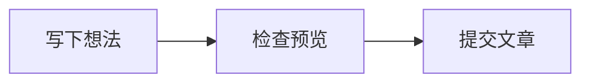

> **示例文章。** 本文用于演示博客的 Markdown 排版，不是软件评测，也不代表下列任务已经完成。

## 先把结构写出来

我会先用二级标题划分主题，再用三级标题记录具体操作。标题最好能回答一个问题，例如“怎么复现”，比“其他内容”更方便以后查找。**粗体**留给关键结论，*斜体*偶尔强调语气，行内代码如 `npm run dev` 则表示需要原样输入的内容。

### 用表格比较，用清单行动

信息并列时可以用表格。它适合几项简短属性，不适合把整段文章塞进格子。

| 内容 | 适合的写法 | 用途 |
| --- | --- | --- |
| 开发步骤 | 有序列表 | 按顺序复现 |
| 今日计划 | 任务清单 | 看清下一步 |
| 参数说明 | 表格 | 快速比较 |

- [x] 写下这次想解决的问题
- [x] 保存一个最小示例
- [ ] 运行示例并补上实际结果

## 把材料和判断分开

引用块可以收起一段值得反复提醒自己的话。这里是我为本页写的句子，不是外部引文：

> 先写清楚一件小事，再慢慢连接成一篇文章。

代码使用围栏，并注明语言。下面演示 JavaScript 怎样为一条笔记添加标签：

```javascript
const note = {
  title: "今天学到的一件事",
  tags: ["笔记", "示例"],
};
console.log(note.title);
```

如果解释会打断正文，可以放进脚注，正文只保留入口。[^draft]

## 给图片一个具体的说明

图片也需要文字。描述画面比写“配图”更有帮助；读不到图片时，读者仍能知道这里想表达什么。以下图片用于演示图片引用：


写完以后，我会回到预览检查标题、链接和代码是否清楚。Markdown 帮我保存结构，内容是否讲明白，仍需要自己读一遍。

## 把流程画出来

也可以用 Mermaid 画一个简单的写作流程：



[^draft]: 浏览器编辑器的本地草稿只保存在当前设备和浏览器。导出文件并提交到仓库后，内容才会随站点更新公开。
