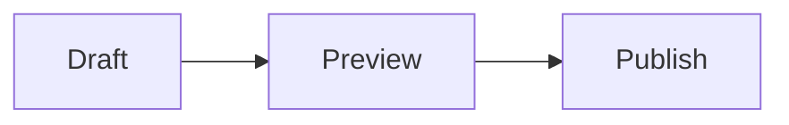

> **Example.** A quick tour of the Markdown supported on this blog.

## Give the page a structure

Use a heading that tells the reader what comes next. Keep paragraphs focused on one idea. Save **bold** for a useful point, *italics* for a little emphasis, and inline code such as `npm run dev` for exact text.

### Tables and tasks

A table helps compare short items. Put longer explanations in the surrounding text so the page stays easy to read on a phone.

| Content | Format | Purpose |
| --- | --- | --- |
| Steps | Numbered list | Follow an order |
| Plans | Checklist | Track the next action |
| Settings | Table | Compare values |

- [x] Describe the question
- [x] Add a small example
- [ ] Check the result

## Keep examples readable

A blockquote can set a short note apart:

> Start with one clear example.

Use a fenced block for code and name its language. This JavaScript example prints a note title:

```javascript
const note = {
  title: "A useful note",
  tags: ["Notes", "Example"],
};
console.log(note.title);
```

Move a small aside into a footnote when it would interrupt the explanation.[^draft]

## Add a picture or a process

Give an image descriptive alt text so its purpose is still clear when the image cannot load.


For a short sequence, Mermaid can make the connections easier to see:



Before publishing, check the preview once: headings, links, code, and image descriptions deserve the same attention as the prose.

[^draft]: Browser drafts stay on this device. Export and commit the file to publish it.
